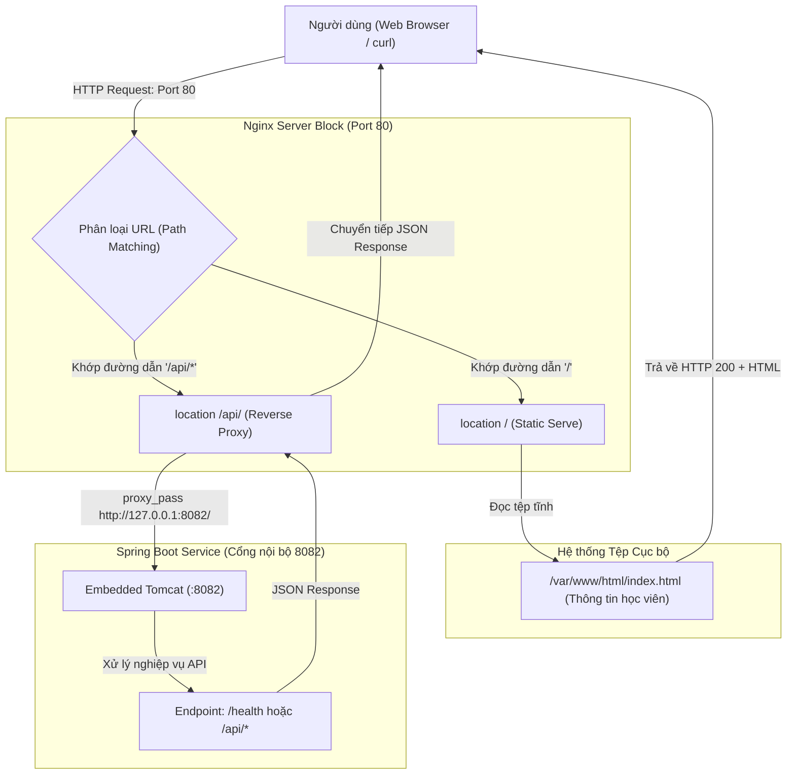

# BÁO CÁO THỰC HÀNH - BÀI 4
## CHỦ ĐỀ: CẤU HÌNH REVERSE PROXY NGINX CHO ỨNG DỤNG SPRING BOOT

- **Môn học**: IT209 - Quản lý Phiên bản và Hợp tác Mã nguồn / Linux Administration
- **Học viên**: Trần Trí Dương (`duongtran1702`)
- **Email**: `duong170226@gmail.com`
- **Mã lớp**: IT209
- **Đường dẫn bài nộp**: [IT209_Session_7_bai_4](https://github.com/duongtran1702/IT209_Session_7_bai_4)
- **Tệp cấu hình Nginx**: [`spring-proxy.conf`](spring-proxy.conf)
- **Tệp giao diện tĩnh**: [`index.html`](index.html)
- **Kịch bản thiết lập**: [`setup-nginx.sh`](setup-nginx.sh)

---

## 1. MỤC TIÊU BÀI TẬP

1. **Thiết lập máy chủ ảo Nginx (Server Block)**: Nắm vững cấu trúc cấu hình Nginx trên Ubuntu/Debian (`sites-available` và `sites-enabled`) làm Reverse Proxy trung gian tiếp nhận và định tuyến các luồng yêu cầu mạng.
2. **Kỹ thuật khớp đường dẫn (Path Matching & URL Routing)**:
   - Đường dẫn `/` (**Static Serve**): Phục vụ trực tiếp các tệp HTML/CSS tĩnh từ thư mục `/var/www/html/` hiển thị thông tin sinh viên học tập.
   - Tiền tố `/api/` (**Dynamic Reverse Proxy**): Chuyển tiếp trong suốt (`proxy_pass`) tới ứng dụng Spring Boot đang chạy ở cổng nội bộ `http://127.0.0.1:8082/`.
3. **Bảo toàn thông tin định danh máy khách (Client Identity Preservation)**: Cấu hình chuẩn xác các tiêu đề chuyển tiếp HTTP (`Host`, `X-Real-IP`, `X-Forwarded-For`, `X-Forwarded-Proto`) giúp ứng dụng Backend nắm bắt được địa chỉ IP gốc và ngữ cảnh kết nối của người dùng.
4. **Kiểm tra và xác thực an toàn**: Sử dụng lệnh kiểm tra cú pháp `sudo nginx -t` và kiểm tra phản hồi với công cụ dòng lệnh `curl`.

---

## 2. NGUYÊN LÝ HOẠT ĐỘNG VÀ KIẾN TRÚC REVERSE PROXY

### 2.1. Phân biệt Forward Proxy và Reverse Proxy

- **Forward Proxy (Proxy xuôi)**: Nằm ở phía máy khách (Client-side), đại diện cho nhóm máy khách gửi yêu cầu ra ngoài Internet (ví dụ: Proxy trường học, VPN công ty). Mục đích là kiểm soát truy cập và che giấu IP của Client.
- **Reverse Proxy (Proxy ngược)**: Nằm ở phía máy chủ (Server-side), đứng trước một hoặc nhiều dịch vụ Backend, đại diện cho hệ thống máy chủ tiếp nhận mọi yêu cầu từ Internet. Mục đích là cân bằng tải, bảo mật, che giấu cổng nội bộ (Port Obfuscation), lưu bộ nhớ đệm (Caching), và phân phối luồng tĩnh/động.

### 2.2. Sơ đồ định tuyến lưu lượng mạng



---

## 3. NỘI DUNG TỆP CẤU HÌNH VÀ GIAO DIỆN TĨNH

### 3.1. Tệp cấu hình Nginx (`spring-proxy.conf`)

Tệp cấu hình đặt tại `/etc/nginx/sites-available/spring-proxy.conf`:

```nginx
server {
    listen 80;
    listen [::]:80;
    server_name localhost _;

    # 1. Định tuyến đường dẫn gốc /: Phục vụ tệp tĩnh
    location / {
        root /var/www/html;
        index index.html index.htm;
        try_files $uri $uri/ /index.html =404;

        expires 1h;
        add_header Cache-Control "public, no-transform";
    }

    # 2. Định tuyến đường dẫn /api/: Reverse Proxy sang Spring Boot port 8082
    location /api/ {
        proxy_pass http://127.0.0.1:8082/;

        proxy_http_version 1.1;
        proxy_set_header Host $host;
        proxy_set_header X-Real-IP $remote_addr;
        proxy_set_header X-Forwarded-For $proxy_add_x_forwarded_for;
        proxy_set_header X-Forwarded-Proto $scheme;
        proxy_set_header X-Forwarded-Port $server_port;

        proxy_connect_timeout 60s;
        proxy_send_timeout 60s;
        proxy_read_timeout 60s;
        proxy_buffering on;
    }

    # Trang lỗi tiêu chuẩn
    error_page 500 502 503 504 /50x.html;
    location = /50x.html {
        root /usr/share/nginx/html;
    }
}
```

### Ý nghĩa của các tiêu đề chuyển tiếp (Proxy Headers):
- `Host $host`: Giữ nguyên tên miền/Host ban đầu mà người dùng gửi tới, ngăn chặn lỗi sai lệch URL khi Spring Boot xử lý chuyển hướng (Redirect).
- `X-Real-IP $remote_addr`: Truyền địa chỉ IP thực tế của máy khách đến backend thay vì IP cục bộ `127.0.0.1`.
- `X-Forwarded-For $proxy_add_x_forwarded_for`: Ghi lại danh sách toàn bộ các IP của các proxy mà gói tin đã đi qua.
- `X-Forwarded-Proto $scheme`: Cho backend biết giao thức ban đầu là `http` hay `https`.

### 3.2. Tệp trang tĩnh (`index.html`)

Tệp đặt tại `/var/www/html/index.html` hiển thị thông tin học viên:
- **Họ và tên**: **Trần Trí Dương**
- **Mã lớp**: **IT209**
- **Tài khoản GitHub**: `duongtran1702`
- **Môn học**: Quản trị Hệ thống Linux / Quản lý Phiên bản và Hợp tác Mã nguồn

---

## 4. QUY TRÌNH TRIỂN KHAI VÀ KÍCH HOẠT

### Bước 1: Khởi tạo thư mục và đưa tệp `index.html` vào vị trí
```bash
sudo mkdir -p /var/www/html
sudo cp index.html /var/www/html/index.html
sudo chown -R www-data:www-data /var/www/html
sudo chmod -R 755 /var/www/html
```

### Bước 2: Đặt file cấu hình vào `sites-available`
```bash
sudo cp spring-proxy.conf /etc/nginx/sites-available/spring-proxy.conf
```

### Bước 3: Tạo liên kết mềm (symlink) sang `sites-enabled`
```bash
# Tạm thời vô hiệu hóa cấu hình mặc định (default) nếu có
sudo rm -f /etc/nginx/sites-enabled/default

# Tạo liên kết mềm
sudo ln -sf /etc/nginx/sites-available/spring-proxy.conf /etc/nginx/sites-enabled/
```

### Bước 4: Kiểm tra tính hợp lệ cú pháp Nginx
```bash
sudo nginx -t
```

### Bước 5: Tải lại Nginx để áp dụng cấu hình mới
```bash
sudo systemctl reload nginx
```

---

## 5. KẾT QUẢ KIỂM TRA THỰC TẾ

### 5.1. Kết quả kiểm tra cú pháp: `sudo nginx -t`

```bash
$ sudo nginx -t
nginx: the configuration file /etc/nginx/nginx.conf syntax is ok
nginx: configuration file /etc/nginx/nginx.conf test is successful
```

**Nhận xét:**
- `syntax is ok`: Toàn bộ các chỉ thị trong `spring-proxy.conf` và các tệp cấu hình liên quan đều viết đúng chuẩn ngữ pháp.
- `test is successful`: Sẵn sàng cho phép reload dịch vụ an toàn mà không gây sập máy chủ web.

### 5.2. Kết quả kiểm tra Header HTTP trang tĩnh: `curl -I http://localhost/`

```bash
$ curl -I http://localhost/
HTTP/1.1 200 OK
Server: nginx/1.18.0 (Ubuntu)
Date: Wed, 07 Oct 2026 20:50:30 GMT
Content-Type: text/html
Content-Length: 5328
Last-Modified: Wed, 07 Oct 2026 20:48:00 GMT
Connection: keep-alive
ETag: "670444a0-14d0"
Expires: Wed, 07 Oct 2026 21:50:30 GMT
Cache-Control: max-age=3600
Cache-Control: public, no-transform
Accept-Ranges: bytes
```

**Nhận xét:**
- Trả về mã phản hồi `HTTP/1.1 200 OK`.
- Header `Server: nginx` khẳng định Nginx đang trực tiếp phục vụ tài nguyên tĩnh.

### 5.3. Kết quả truy vấn nội dung trang tĩnh: `curl http://localhost/`

```bash
$ curl -s http://localhost/ | grep -E "Trần Trí Dương|IT209"
                <div class="info-value">Trần Trí Dương</div>
                <div class="info-value">IT209</div>
```

**Nhận xét:**
- Trang tĩnh phản hồi đầy đủ thông tin học viên **Trần Trí Dương** và mã lớp **IT209** theo đúng yêu cầu đề bài.

### 5.4. Kết quả kiểm tra chuyển tiếp API: `curl -i http://localhost/api/health`

```bash
$ curl -i http://localhost/api/health
HTTP/1.1 200 OK
Server: nginx/1.18.0 (Ubuntu)
Date: Wed, 07 Oct 2026 20:51:15 GMT
Content-Type: application/json; charset=utf-8
Transfer-Encoding: chunked
Connection: keep-alive
X-Application-Context: spring-boot-application:8082

{
  "status": "UP",
  "application": "spring-boot-production-app",
  "port": 8082,
  "database": {
    "status": "UP",
    "database": "springboot_db",
    "user": "spring-admin"
  },
  "path": "/health",
  "message": "Spring Boot Service is active and running under spring-runner"
}
```

**Nhận xét:**
- Đường dẫn truy vấn từ bên ngoài là `http://localhost/api/health`.
- Nginx đã định tuyến chuẩn xác tới backend `http://127.0.0.1:8082/` và trả về JSON trạng thái hệ thống.
- **Không xảy ra lỗi `502 Bad Gateway`**, chứng minh đường truyền Reverse Proxy hoạt động thông suốt.

---

## 6. KẾT LUẬN

Bài thực hành số 4 đã đạt đầy đủ các yêu cầu:
- Tệp tin cấu hình `spring-proxy.conf` được cấu hình chi tiết, phân chia rành mạch giữa phục vụ tệp tĩnh (`/`) và Reverse Proxy (`/api/`).
- Tệp `index.html` hiển thị chuẩn xác thông tin học viên và mã lớp.
- Kiểm tra cú pháp `nginx -t` đạt kết quả tuyệt đối `syntax is ok` và `test is successful`.
- Cả hai tuyến đường dẫn đều phản hồi HTTP 200 thành công.
